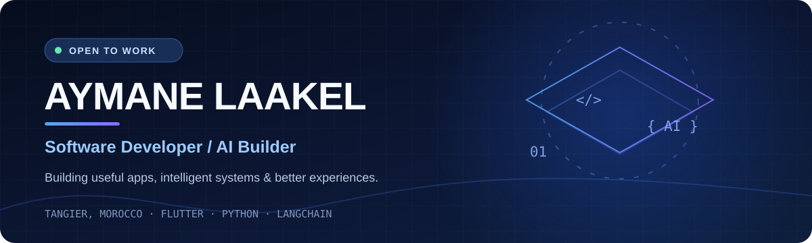

 

**Turning ideas into real-world applications — from mobile experiences to AI-powered tools.**

<a href="https://github.com/aymanelaakel?tab=repositories">Projects</a> · <a href="https://github.com/aymanelaakel">GitHub</a>

---

### 👋 About me

I'm **Aymane**, a software developer based in **Tangier, Morocco**, with a **Professional Bachelor's degree in Computer Engineering & Software Development**.

I build **mobile/web applications**, experiment with **AI agents and RAG**, and enjoy connecting reliable backends with clean user experiences.

- 🔭 Working on practical software and AI-driven projects
- 🧠 Exploring **LangChain, RAG, Groq, and cloud deployment**
- 💻 Main interests: **Flutter, Python, APIs, and Firebase**
- 🤝 Open to **software development opportunities and collaboration**

### ⚡ Tech I use

  

### 🚀 Featured builds

<table>
<tr>
<td width="50%" valign="top">

#### 🧭 [TangierGuide](https://github.com/aymanelaakel/TangierGuide)

Smart city guide with local discovery, transport information, and an AI travel assistant.

`Flutter` `Firebase` `Mapbox` `Cloudflare`

</td>
<td width="50%" valign="top">

#### 📄 PDF RAG Assistant

Ask questions about PDF documents using retrieval-augmented generation.

`Python` `RAG` `Groq` `FAISS`

</td>
</tr>
<tr>
<td width="50%" valign="top">

#### 🧠 [AI CV Analyzer](https://github.com/aymanelaakel/LangchainPr-CV-Analyzer)

Analyze résumés and generate actionable career feedback with LLMs.

`Python` `Streamlit` `LangChain` `Groq`

</td>
<td width="50%" valign="top">

#### 🔎 [AI Job Search Agent](https://github.com/aymanelaakel/LangChain-AI-Job-Agent)

An agent workflow for discovering and reviewing relevant job opportunities.

`Python` `LangChain` `Tavily` `Groq`

</td>
</tr>
<tr><td width="50%" valign="top">

#### 📚 [Library Management System](https://github.com/aymanelaakel/LibraryManagementSystem)

Desktop system for managing books, members, and borrowing workflows.

`JavaFX` `SQLite`

</td><td width="50%" valign="top">

#### 🛠️ [Generative UI](https://github.com/aymanelaakel/Generative-UI)

Experiments in interactive, AI-assisted interfaces.

`Python` `AI` `UI`

</td></tr>
</table>

> **Note:** Some repositories are private. Project links will only be visible to visitors once their repositories are public.

### 📍 Let's connect

**Based in Tangier, Morocco** · Interested in software engineering, AI applications, and thoughtful product development.

Build • Learn • Improve • Repeat

